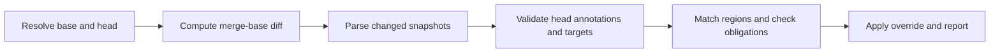

# IFTTT Lint: Cross-File Change Coupling Check — Design Spec

Oct 5, 2026 · @Jiahao Cai

## Overview

IFTTT ("If This Then That") is a presubmit check that warns when a change edits one region of code but not the region it is declared to be coupled with. Authors mark coupled regions with `LINT.IfChange` / `LINT.ThenChange` comments; the tool compares those markers against the change's diff.

**Problem.** Many invariants span files the build system cannot see as linked: an enum and its string table in another language, a proto and its hand-written validator, a constant and the docs that quote it, a schema and its migration. Today these drift silently until a runtime bug or a confused reader finds them. IFTTT turns that tribal knowledge into a machine-checked reminder at review time.

**Scope note.** This spec describes a tool modeled on Google's internal IFTTT lint as visible from its annotations in public Google repositories (Chromium, Android, TensorFlow, Fuchsia). Internal implementation details are not public; where this spec makes a design choice, it is our own.

**v1 target.** A Go CLI, shipped as a GitHub Action, that runs on pull requests and reports guarded regions whose declared counterparts were not changed.

## Goals and non-goals

**v1 goals**

- Guard related changes: authors declare a coupling between regions with `LINT.IfChange` / `LINT.ThenChange` comments.
- On every pull request, a GitHub Action reports each guarded region that changed while a declared counterpart did not.
- Findings show up where reviewers look: inline on the PR's changed files and in the job summary.
- One escape hatch: `NO_IFTTT=<reason>` in the PR description.

**Non-goals**

- Checking that the counterpart change is *correct*. IFTTT only checks that both sides were touched.
- Inferring couplings automatically. All links are declared by humans.

**Later (cut from v1)**

- Per-target overrides, strict/blocking mode per directory, and per-directory config files.
- Working-tree/staged-file mode and a pre-commit hook. The v1 CLI can check committed refs locally.
- Nightly repo-wide validation of broken links.
- Rename tracking, generated-file warnings, and special handling for large codemods.
- Checking a stack of PRs as one unit.

## Annotation syntax

A coupled region is opened by `LINT.IfChange` and closed by `LINT.ThenChange(...)`, each on its own line inside a comment. The lines between them are the guarded region.

```
// LINT.IfChange(colors)
enum Color { RED, GREEN, BLUE };
// LINT.ThenChange(//ui/strings/color_names.py:colors, //docs/colors.md)
```

**Directives**

| Directive | Form | Meaning |
| --- | --- | --- |
| Open | `LINT.IfChange` | Starts an unlabeled guarded region. |
| Open, labeled | `LINT.IfChange(label)` | Starts a region other files can target as `path:label`. |
| Close | `LINT.ThenChange(target, ...)` | Ends the region and lists one or more targets. |
| Close, no target | `LINT.ThenChange()` | Ends a region that is only a target, never a source. |

**Target forms**

- `path/to/file.ext`: the whole file. Paths are relative to the repository root; a leading `//` is accepted and ignored, for Google-style annotations.
- `:label` (empty path): a labeled region in the same file.
- `path:label`: the labeled region in another file.
- Multiple targets are comma-separated; the list may wrap across consecutive comment lines.

**Comment styles.** The directive is recognized on a standalone comment line using a per-extension table: `//`, `#`, `--`, `;`, `%`, `<!-- -->`, `/* */`, `'` (VB), and `REM`. A lightweight lexer tracks each language's string delimiters and block comments before matching directives. Strings that cannot span lines in the language end with their line, so a stray quote character cannot hide later directives; quote characters that are not string delimiters (Rust lifetimes, Lisp quote, TeX prose) never open a string. A directive hidden by a string that never closes is an annotation error. Markdown fences and YAML block scalars are skipped. Inline comments after code are ignored. Unknown extensions and NUL-containing files are not annotation sources, but can be whole-file targets. Heredocs, custom raw-string delimiters, regex literals, interpolation, and embedded languages are not fully modeled; v1 does not guarantee perfect string detection for every language. See the extension table in `internal/lint/comments.go`.

**Paths.** Targets must be tracked regular files. Reject absolute paths, `..` components, backslashes, control characters, commas, parentheses, and colons except the label separator. Normalize a leading `//` and `./`; paths remain case-sensitive. Spaces are allowed. Symlinks, directories, and submodules are not valid targets.

**Labels.** Matching `[A-Za-z0-9_.-]+`, unique within a file. Regions do not nest; a second `IfChange` before the matching `ThenChange` is an error.

**Symmetry.** Links are one-directional as written. For a two-way coupling, both files carry an `IfChange` / `ThenChange` pair pointing at each other, which is the recommended pattern.

## Detection semantics

A warning fires when a change modifies lines inside a guarded region and, for at least one listed target, modifies nothing inside that target.

**Algorithm, per pull request:**

1. Collect the diff: from git diff between the PR's merge base and head, for each changed file, the set of added, removed and modified line ranges, in both the old and new versions.
2. Scan only changed files for `IfChange` / `ThenChange` pairs, in both versions. Unchanged files cannot trigger, so they are never scanned as sources.
3. Match old and new regions first by non-empty label, then by surviving marker or body lines mapped through the diff. A pre-existing region is **triggered** if any changed line falls strictly between its `IfChange` and the first line of its `ThenChange` in either version. Removed lines count via the old version, added lines via the matched new region. Unmatched new regions are exempt; unmatched old regions can trigger on removed body lines. For a triggered matched region, evaluate the union of old and new target lists, deduplicated by target.
4. For each target of a triggered region, decide whether it was **satisfied**:
   - Whole-file target: satisfied if the file has any change in this CL.
   - Labeled target: inspect the label in both versions; removals inside the old body or additions inside the new body satisfy it. A deleted target file also counts as satisfied.
5. Each unsatisfied target produces one finding, unless overridden (see Presubmit integration).

**What counts as a change**

- Edits to the marker lines themselves, including all continuation lines of a wrapped target list, do not trigger the region. Adding or rewording a `ThenChange` target list should not demand an edit elsewhere. If the body also changes, old obligations still apply alongside new ones.
- Whitespace-only and comment-only edits do trigger by default. v1 has no option to exclude them, because comments are often the coupled content (docs, examples).
- Creating a brand-new region in a PR does not trigger it; the author is establishing the link, not changing guarded content.
- Deleting an entire non-empty region (markers and body) triggers it. Removing coupled code is exactly when the counterpart may need to go too. Removing only markers does not trigger; empty regions have no body changes to trigger.

**Granularity.** Findings are per (source region, target) pair. A region listing three targets where two were edited yields one finding naming the third.

## GitHub Action integration

The Action runs on `pull_request`, diffs the PR's merge base against its head, and reports each missed counterpart as an inline warning on the PR plus a summary table.

**Usage**

```yaml
name: ifttt
on:
  pull_request:
    types: [opened, synchronize, reopened, edited]
permissions:
  contents: read
jobs:
  ifttt:
    runs-on: ubuntu-latest
    steps:
      - uses: actions/checkout@v7
        with:
          fetch-depth: 0   # needed to compute the merge base
      - uses: <owner>/ifttt@v1
        with:
          fail-on-findings: true   # default false: warn only
```

**Inputs**

| Input | Default | Meaning |
| --- | --- | --- |
| `fail-on-findings` | `false` | Fail the job when there are unoverridden findings. |
| `base-ref` | PR base SHA from event | Ref used to compute the merge base; rarely needed. |

**Reporting**

- Each finding is emitted as a workflow annotation (`::warning file=...,line=...::`) on a changed head-side body line when available. Inline display depends on GitHub's mapping to the PR diff. Deletion-only changes use file-level annotations; deleted files use general annotations. Both retain source coordinates in the message and summary.
- A Markdown table of all findings is written to the job summary (`$GITHUB_STEP_SUMMARY`).

```
IFTTT: ui/color.h:12-18 (colors) changed, but
ui/strings/color_names.py:colors was not.
If no update is needed, add NO_IFTTT=<reason> to the PR description.
```

**Override.** `NO_IFTTT=<reason>` in the PR description silences all coupling findings for that PR. Match a token boundary before `NO_IFTTT`; the reason must contain non-whitespace text on the same line. HTML comments in the description (hidden on GitHub, common in PR templates) are ignored, and so are placeholder reasons that start with `<…>`, such as `<reason>`. The Action reads the description from the event payload. Subscribe to `pull_request.edited` so description edits start a fresh run with the updated body; rerunning an old event does not refresh it. The summary records the reason. Annotation errors are never suppressed.

**Exit codes:** `0` clean or overridden, `1` findings with `fail-on-findings`, `2` annotation errors, `3` tool failure.

## Annotation validation

Head annotations in changed files are validated on every run, including new and untriggered regions. Every declared target must exist at head. Labeled target files are also parsed and syntax-checked, without recursively validating their outgoing links. Historical parse errors are ignored so they can be fixed or deleted. Validation errors always fail the job (exit code `2`) and cannot be silenced with `NO_IFTTT`, because a broken link silently guards nothing. Incoming references from untouched source files are outside this validation scope.

| Error | Example |
| --- | --- |
| Unclosed region | `IfChange` with no `ThenChange` before end of file |
| Orphan close | `ThenChange` with no open region |
| Nested region | Second `IfChange` before the first closes |
| Duplicate label | Two `IfChange(colors)` in one file |
| Invalid syntax or target path | Malformed labels, target lists, or paths containing `..` |
| Missing target file | `ThenChange(ui/old_name.py)` where the path does not exist |
| Missing target label | `path:colors` where that file has no `IfChange(colors)` |

## Edge cases

| Case | v1 behavior |
| --- | --- |
| Target file deleted in the PR | Counts as satisfied. Remaining links in changed source files are validation errors; untouched sources are not searched. |
| Target file renamed in the PR | Treated as delete + add: the old path is satisfied; stale links in changed source files are validation errors. |
| Source and target in the same file | Supported via `:label`, evaluated against the same diff. |
| Coupled change split across PRs | Each PR is checked alone; use `NO_IFTTT=done in #123`. |
| Cycles (A → B → A) | Fine. Checking is one hop only, so cycles cannot loop. |

## Architecture

The check is a stateless pipeline over a single change; no repository-wide index is needed in CI.



Changed files are scanned as sources in both versions. Target contents are loaded lazily for head validation and triggered coupling checks, with a per-run cache. Tree metadata is enumerated without parsing unchanged file contents. There is no persistent index or recursive link traversal.

**Implementation notes**

- **Language:** Go, standard library only where possible. Builds to one static binary per platform.
- **Diff source:** resolve refs to commit IDs, compute the merge base, and use `git diff --no-renames --unified=0 --inter-hunk-context=0`. Disable external diff/textconv, pin the diff algorithm, and use literal pathspecs. NUL-delimited names handle unusual paths. Both versions' contents are read from Git blobs, so dirty worktrees and checkout's default PR merge commit do not affect the result. The Action uses the event's explicit base/head SHAs.
- **Comment table:** a per-extension map of comment leaders, built into the binary.
- **Packaging:** see Distribution below. The Action is a composite `action.yml` that downloads the release binary for the runner and runs it, so there is no Docker build and startup is about a second.
- **PR description:** read from `$GITHUB_EVENT_PATH` (`pull_request.body`); no API token needed.
- **Tests:** table-driven Go tests over fixture repos (small git repos built in a temp dir with a known diff and expected findings).

### Distribution

Binaries are hosted as GitHub Release assets in the same repository as the Action, so each Action version runs exactly the binary built from the same tag.

- **One repo** holds the Go code, `action.yml`, `.goreleaser.yaml` and the release workflow.
- **Release flow:** pushing a tag `v1.x.y` runs GoReleaser, which builds `linux/amd64`, `linux/arm64`, `darwin/arm64` and `windows/amd64` and uploads them plus `checksums.txt` to that tag's release.
- **Action download:** the composite Action reads the concrete tag from its committed `action-version` file, picks the asset for `runner.os` / `runner.arch` from `https://github.com/<owner>/ifttt/releases/download/<tag>/`, verifies the SHA-256 checksum, and runs it. Public release assets are required. The release workflow requires `action-version` to match the pushed tag.
- **Version pinning:** after a successful release, the floating `v1` tag moves to the release commit. The embedded version keeps `v1`, exact tags, and release commit-SHA pins tied to their own binary; no independent latest-release lookup occurs. Untagged development commits are tested from source.
- **Local installs** use the same release assets; a Homebrew tap can be added later from the same GoReleaser config.

| Rejected option | Why |
| --- | --- |
| Binary committed to the repo | Bloats git history every release; still needs one binary per platform. |
| Docker image on GHCR | Docker actions run only on Linux runners and add image pull time per job. |
| `go install` at runtime | Needs `setup-go` plus a compile on every run, adding tens of seconds per PR. |

## Shipping v1

1. **Core library + CLI.** Parser, diff reader, matcher, and `ifttt check --base <ref>` printing findings and exiting with the codes above.
2. **Fixture tests.** Cover each rule in Detection semantics and every validation error, including deleted lines and edits on marker lines.
3. **GitHub output.** Workflow annotations, job summary, and the `NO_IFTTT` override read from the event payload.
4. **Release.** GoReleaser binaries plus a composite `action.yml`; tag `v1`.
5. **Dogfood.** Run it in one or two of your own repos in warn-only mode for a few weeks, then publish to the GitHub Marketplace.

**Resolved:** whitespace-only edits trigger in v1.
